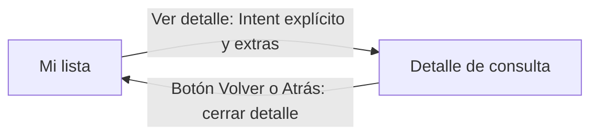

# Pantallas, funcionalidades y flujo de la etapa local

**Pendiente de actualización para la entrega definitiva:** este documento no incluye la búsqueda TMDB, las tarjetas de resultados ni los créditos ya implementados. Ver el README principal para el alcance vigente.

## Alcance

Mis Películas permite organizar una lista personal de películas pendientes y vistas. Mantiene Java/XML, dos Activities y diseño oscuro: fondo #141414, rojo #E50914, texto blanco y secundario #B3B3B3. Se usan ConstraintLayout, LinearLayout vertical/horizontal, Button, TextView, ImageView y ScrollView.

## P01 — Mi lista (MainActivity)

Muestra título, contador de guardadas/vistas, formulario de alta y tarjetas desplazables. Al crear una base nueva sin estado anterior recuperable aparecen Interestelar pendiente, Shrek vista y Spider-Man pendiente: 3/1. En aperturas posteriores se carga SQLite, incluso cuando no tiene registros.

| Acción | Comportamiento implementado |
|---|---|
| Agregar vacío o espacios | Mensaje de validación; no altera datos ni contadores. |
| Agregar título válido | Guarda una entrada pendiente con ID único, crea su tarjeta y limpia el campo si el guardado fue correcto. |
| Agregar un título repetido | Conserva ambas entradas como objetos/registros independientes. |
| Marcar como vista | Actualiza SQLite y el objeto; muestra Vista y deshabilita ese botón. |
| Eliminar pendiente o vista | Elimina por ID y actualiza colección, tarjeta y contadores. |
| Ver detalle | Abre P02 con título, estado actual e identificador de imagen; no modifica la lista. |
| Desplazar lista | Permite alcanzar todas las tarjetas y botones. |

Los contadores se derivan de ArrayList<Pelicula>: total = tamaño y vistas = objetos con vista true. No se usa el estado de botones como fuente de datos. Si falla SQLite se informa un error y no se representa una modificación como guardada.

Una lista vacía voluntaria conserva contador 0/0 y formulario. No se recargan los ejemplos. El mensaje personalizado de vacío del mock inicial permanece como propuesta, no como función implementada.

## P02 — Detalle (DetallePeliculaActivity)

Pantalla de consulta con encabezado, imagen local ampliada, título completo, estado, año, género, Sinopsis y botón Volver a mi lista, todo dentro del ScrollView existente. Mantiene el póster y no permite editar, eliminar ni puntuar desde el detalle.

- Título reconocido: ficha verificada de Interestelar (2014), Shrek (2001) o Spider-Man (2002), consultada en CatalogoPeliculas.
- Título desconocido: Descripción no disponible; año y género ocultos. No se inventa información.
- Imagen ausente/no reconocida: recurso genérico y aviso Imagen no disponible.
- Datos de navegación inválidos: mensaje No se pudo abrir esta película; se ocultan estado, imagen y ficha, con regreso disponible.

Las variantes de títulos usan la misma identificación del catálogo para imagen y ficha. Todos los archivos drawable permanecen sin cambios. La ilustración actual de Spider-Man se conserva por instrucción del estudiante: la ficha textual corresponde a la película de 2002, pero no se afirma que la imagen sea su póster oficial.

## Navegación y contrato

| Extra | Tipo y validación |
|---|---|
| titulo | String requerido, no vacío tras trim. |
| vista | Boolean requerido y de tipo correcto. |
| imagenResId | Integer opcional; solo se cargan los tres pósters conocidos, con alternativa ante valores inválidos. |

El botón de regreso usa finish(); Atrás conserva el comportamiento de Android. No se envía otro Intent hacia MainActivity. Las fichas se consultan localmente con el título; no se agregaron extras para año/género/sinopsis.

## Estado y persistencia

SQLite conserva entradas, estados y eliminaciones entre sesiones. La recreación de MainActivity consulta la base y reconstruye tarjetas una vez. No se reinsertan los datos restaurados ni se suma otra lista desde Bundle. Un Bundle válido de la versión anterior solo puede importarse al crear la primera base, incluyendo una lista vacía. El detalle se recrea usando su Intent actual.

No hay Firebase, API, Room ni funcionalidad de estrellas. La base solo reserva una columna opcional para una futura calificación aprobable por separado.

## Mocks y evidencia

Los [mocks iniciales](mocks/pantallas.png) y [flujo visual](mocks/flujo.png) muestran la organización aprobada antes de agregar fichas. El [mock de estados](mocks/estados.png) incluye el mensaje de lista vacía todavía no implementado. Son diseños, no pruebas.

Capturas reales: [lista con tres películas](sqlite-evidencia/inicial.png) y [ficha de Interestelar](fichas-evidencia/detalle.png). Ver [matriz y pruebas](evidencia-y-validacion.md) para límites de la validación.
